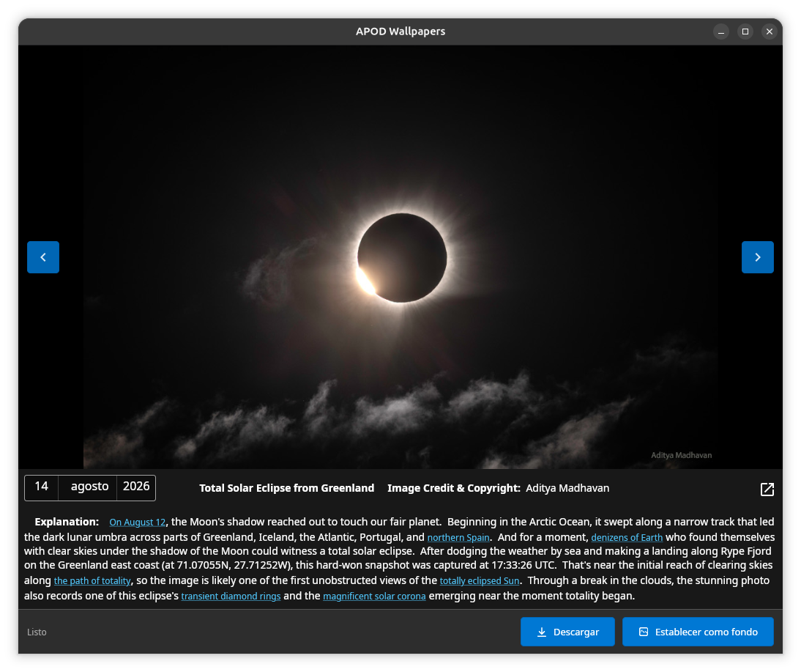

# APOD Wallpapers

> [!NOTE]
> **Desarrollo asistido por IA:** en el desarrollo de esta aplicación se han utilizado herramientas de inteligencia artificial como apoyo. Peso estimado de cada autor por área:

| Área | Daniel Belén Del Río | Claude Opus 5.5 |
|------|-----:|-----:|
| Requisitos e ideas de producto | 95 % | 5 % |
| Diagnóstico de problemas | 65 % | 35 % |
| Decisiones de diseño | 80 % | 20 % |
| Código escrito | 65 % | 35 % |
| Pruebas y detección de fallos | 75 % | 25 % |
| Control del proceso (plan, commits, alcance) | 95 % | 5 % |

Aplicación de ejemplo en .NET multiplataforma que descarga la imagen del día de la APOD y da opción de establecerla como fondo de pantalla sin necesidad de navegador. Tiene versión UI o versión de consola, por lo que puede usarse para crear una tarea programada.

## Ajustes

Desde el botón de ajustes (el engranaje a la izquierda de **Descargar**) se puede elegir la carpeta donde se guardan las imágenes descargadas. Si se deja vacía (por defecto), la aplicación pregunta dónde guardar cada imagen.

Los ajustes se guardan en un archivo `settings.json`, que se busca en este orden:

1. El directorio de trabajo desde el que se abre la aplicación. En Windows se puede elegir con el campo **Iniciar en** de un acceso directo.
2. La carpeta donde está el ejecutable.
3. La carpeta de configuración del usuario:

| Sistema | Ruta |
|---------|------|
| Linux   | `$XDG_CONFIG_HOME/APOD Wallpapers/settings.json` (por defecto `~/.config/APOD Wallpapers/settings.json`) |
| macOS   | `~/.config/APOD Wallpapers/settings.json` |
| Windows | `%APPDATA%\APOD Wallpapers\settings.json` |

Los cambios se guardan en el archivo del que se cargaron; si no existe ninguno, se crea en la carpeta de configuración del usuario.

El botón **Editar JSON** del panel abre ese archivo con la aplicación predeterminada del sistema para los `.json` (si aún no existe, lo crea antes). Los cambios hechos así se aplican en la siguiente descarga, sin reiniciar la aplicación.
