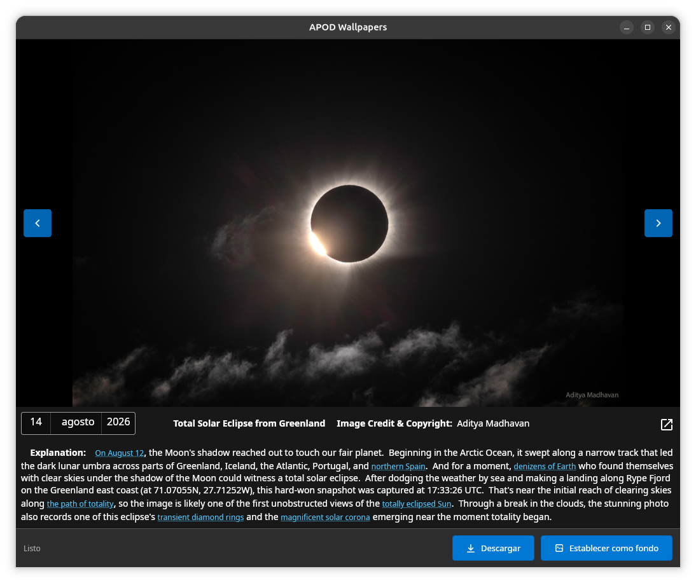

# APOD Wallpapers

> [!NOTE]
> **Desarrollo asistido por IA:** en el desarrollo de esta aplicación se han utilizado herramientas de inteligencia artificial como apoyo. Peso estimado de cada autor por área:

| Área | Daniel Belén Del Río | Claude Opus 5.5 |
|------|-----:|-----:|
| Requisitos e ideas de producto | 95 % | 5 % |
| Diagnóstico de problemas | 65 % | 35 % |
| Decisiones de diseño | 80 % | 20 % |
| Código escrito | 65 % | 35 % |
| Pruebas y detección de fallos | 75 % | 25 % |
| Control del proceso (plan, commits, alcance) | 95 % | 5 % |

Aplicación de ejemplo en .NET multiplataforma que descarga la imagen del día de la APOD y da opción de establecerla como fondo de pantalla sin necesidad de navegador. Tiene versión UI o versión de consola, por lo que puede usarse para crear una tarea programada.
